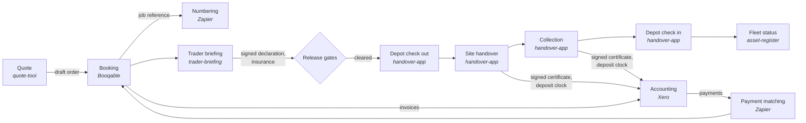

# How the operations system fits together

This is the operating system I designed and built for Acme Hire (anonymised), a UK company that hires out container kitchens and bars for events and festivals. I joined when the business was a concept. The aim was a set of systems that let a small team run nationwide events without things slipping through the gaps, and that would stand up to scrutiny ahead of an equity raise.

## The job lifecycle

Every hire follows one path, and each step has a system that owns it:

| Stage | System | What a person still decides |
| --- | --- | --- |
| Quote | [`quote-tool`](quote-tool) prices from the rate card and sends a draft order | Price overrides and whether to send |
| Booking | Booqable, the single source of truth for orders | Confirming the order |
| Job number | Zapier assigns the next job reference across Booqable and Xero | Nothing |
| Trader onboarding | [`trader-briefing`](trader-briefing) collects the declaration, insurance and artwork | Reviewing insurance flagged by the AI check |
| Release gates | Booking fields for insurance, personal guarantee and "cleared for delivery" | Clearing the booking for delivery |
| Handover and collection | [`handover-app`](handover-app) records condition with photos and signed certificates | Any damage charge |
| Fleet | [`asset-register`](asset-register) shows unit status, GPS and inspection badge | Taking a unit out of service |
| Accounting | Payment rules in [`xero-automation`](xero-automation) (dry run), payment matching in Zapier | Approving every invoice and journal |

## Automations between the tools

Small automations do the routine joins, and each one posts to a private Slack bookings channel so the team can see what happened:

- **Job numbering:** when an order is reserved, assign the next job reference (the highest across Xero invoices, credit notes and Booqable, plus one) and write it to the booking.
- **Blocked booking alert:** when an order starts and the release gates are not cleared, alert the team before the unit leaves.
- **Payment to booking:** when a customer payment lands in Xero, find the booking by its job reference, record the payment against it (splitting deposit and balance), skip duplicates, and send anything it cannot match to a person.
- **Alert relay:** one webhook that every internal app posts to, so alert formatting and the channel are managed in one place.
- **Scheduled chasers:** unsigned trader declarations (D-14, D-10, D-7, then daily from D-3), unsigned handover certificates (day 3 and day 7 of the response window) and the 14-day deposit refund deadline.

## Shared foundations

- **One identity.** Every internal tool uses Google sign-in on the company domain, verified on the server. The [staff hub](staff-hub) is the front door.
- **Secrets in one place.** Credentials live in the [vault](vault) behind two-step sign-in, with an audit log. No tool stores another tool's keys.
- **One domain plan.** Each tool has its own subdomain on the company domain, with HTTPS certificates. I wrote the DNS change sheet, and the DNS provider applied it.
- **AI where it removes a manual check, never where it makes a decision.** Claude reads documents (insurance certificates, hire agreements), checks photo quality, compares condition photos and drafts summaries. People make the decisions on money, damage and release.

## Operating principles

1. **Draft first, human confirms.** Anything that touches money or a customer is created as a draft, or runs in test mode until a person turns it on.
2. **Default to safe.** Live sending needs an exact opt-in value. Unset means off.
3. **Server-side trust.** The browser never decides who you are, which deal you can update, or what data you see.
4. **Visible by default.** Automations report to a shared channel, and gaps (an unmatched payment, an unsigned declaration) go to a person rather than failing silently.
5. **Tested rules.** Business rules (payment schedules, chasing days, access control) are written as code with tests: 88 automated tests across the apps in this repo.
6. **Ship in stages.** Each tool went live as the smallest useful version, was checked against real jobs (including an end-to-end test booking through every system), and was then extended.
